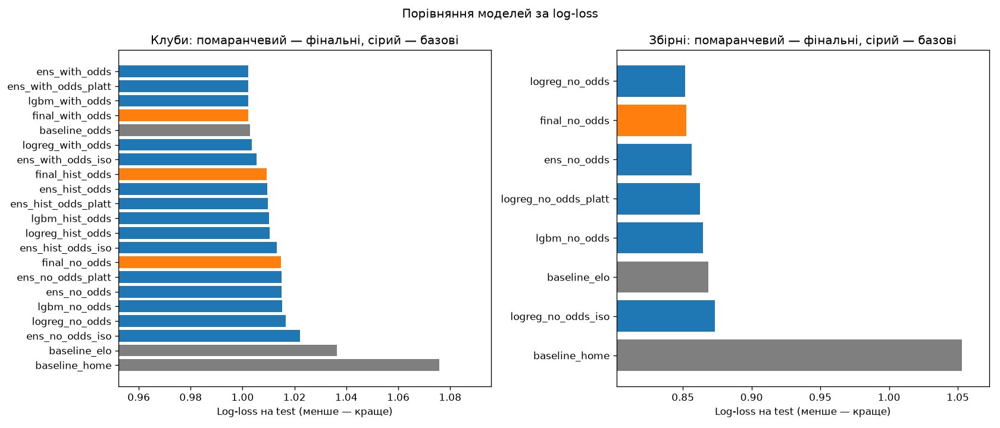
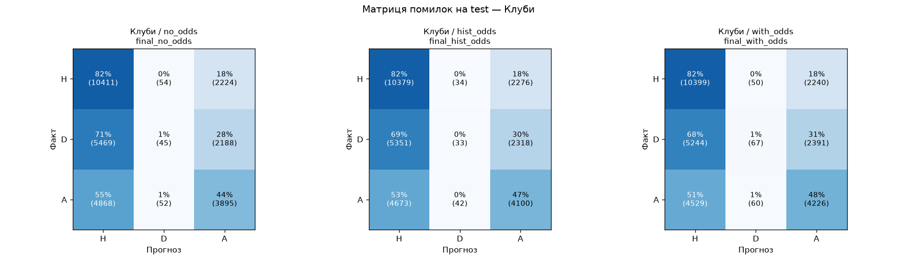
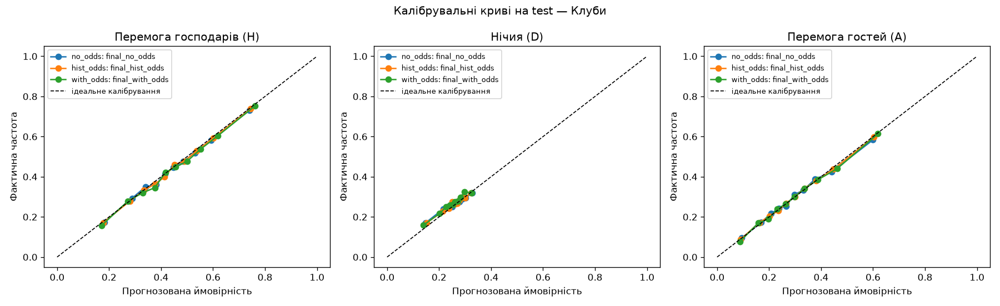
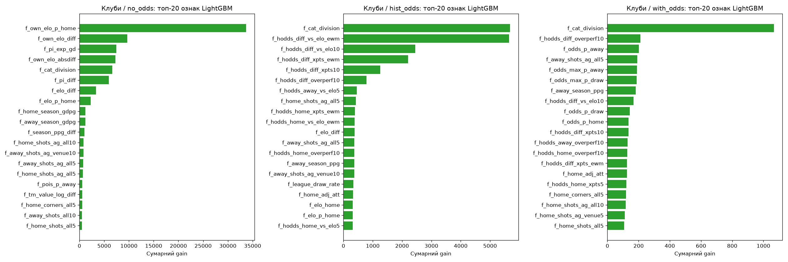
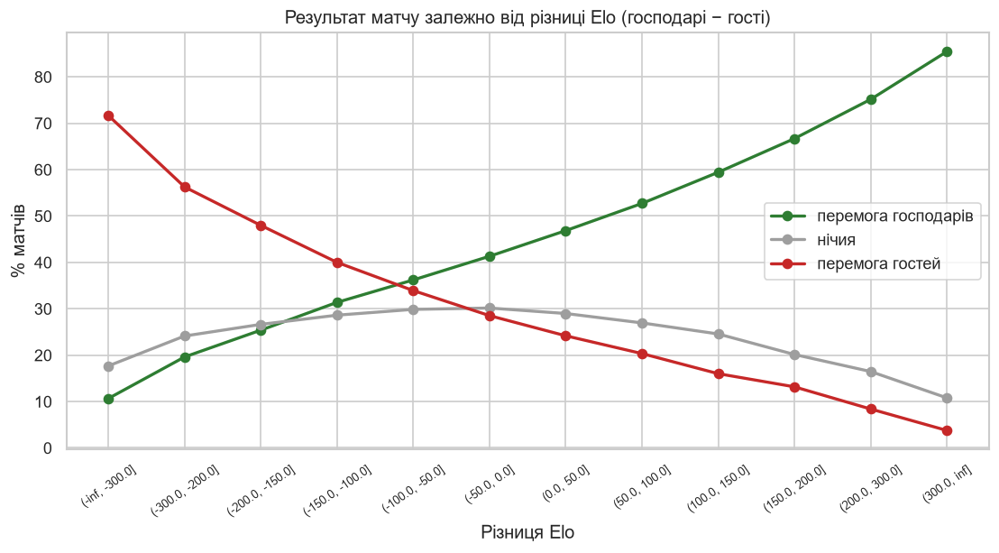
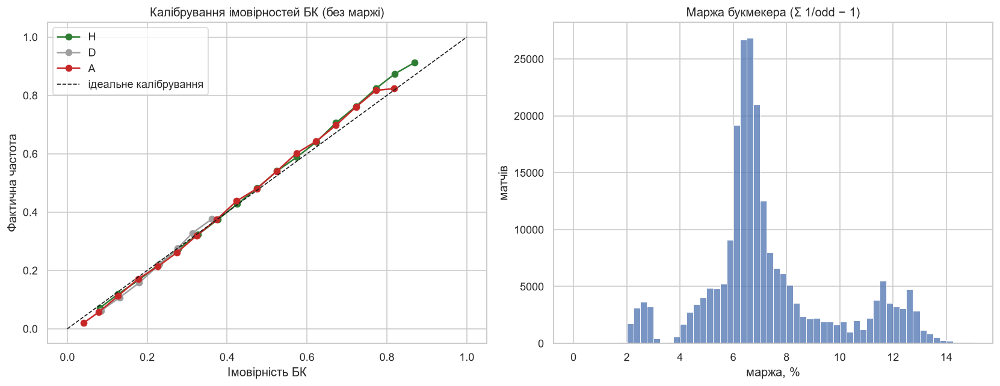
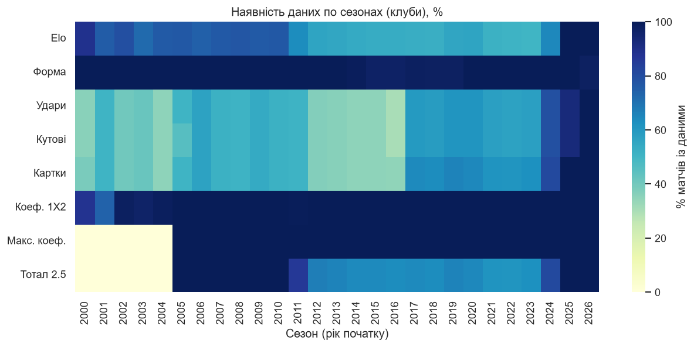

# Прогноз результату футбольного матчу (H / D / A)

Проєкт для хакатону KSE «Python Open Data». Модель за даними, відомими до стартового свистка, оцінює імовірності трьох результатів: перемога господарів (H), нічия (D), перемога гостей (A). Два треки:

- **клуби** — 238 тис. матчів 38 ліг за 2000–2026 роки;
- **національні збірні** — 26 тис. матчів з 2000 року (історія з 1872-го потрібна для рейтингу Elo).

Для клубів є дві моделі: без коефіцієнтів букмекерів (чесний прогноз «з футбольних даних») і з ними. Поруч — демо на Streamlit, де можна вибрати команди й дату і подивитися прогноз.

## Дані та джерела

Усі дані відкриті й завантажуються скриптом `src/download.py` у `data/raw/` (сирі файли ми не змінюємо).

| Файл | Джерело | Що всередині |
|---|---|---|
| `Matches.csv` | [xgabora/Club-Football-Match-Data](https://github.com/xgabora/Club-Football-Match-Data) | 238 859 клубних матчів 2000–2026: ліга, дата, команди, Elo до матчу, форма, рахунок, удари, кутові, картки, коефіцієнти 1X2, тотали, фори |
| `EloRatings.csv` | там само | історія клубних рейтингів Elo (274 тис. записів, 984 клуби) |
| `results.csv` | [martj42/international_results](https://github.com/martj42/international_results) | матчі збірних з 1872 року: рахунок, турнір, місто, нейтральне поле |
| `shootouts.csv` | там само | серії пенальті |
| `former_names.csv` | там само | колишні назви збірних |
| `goalscorers.csv` | там само | автори голів: хвилина, пенальті, автогол (завантажує `clean_intl.py`) |
| `transfermarkt/*.csv.gz` | [dcaribou/transfermarkt-datasets](https://github.com/dcaribou/transfermarkt-datasets) | матчі з тренерами, виходи гравців на поле, історія оцінок гравців — для вартості складу (завантажує `download_extra.py`, необов'язкове джерело) |

Обидва репозиторії публічні на GitHub і розповсюджуються як відкриті дані (умови — у файлах ліцензій самих репозиторіїв). Ми використовуємо їх лише з навчальною метою й посилаємося на авторів. Набір клубних даних, у свою чергу, зібраний із football-data.co.uk і ClubElo.

## Структура проєкту

```
хакатон/
├── data/
│   ├── raw/                 # сирі CSV (download.py)
│   └── processed/           # clubs_matches, clubs_features, intl_matches, intl_features (.parquet)
├── models/                  # clubs_no_odds, clubs_with_odds, intl (.joblib) — не комітиться
├── notebooks/
│   └── eda.ipynb            # розвідувальний аналіз
├── reports/
│   ├── metrics.md, metrics.csv
│   ├── feature_importance_<track>.csv
│   └── figures/             # графіки EDA (eda_*.png) і моделей
├── src/
│   ├── config.py            # шляхи, дати розбиття, константи
│   ├── download.py          # завантаження сирих даних
│   ├── clean.py             # диспетчер → clean_clubs.py, clean_intl.py
│   ├── features.py          # диспетчер → features_clubs.py, features_intl.py
│   ├── elo_intl.py          # власний Elo для збірних
│   ├── download_extra.py    # необов'язкові джерела (Transfermarkt)
│   ├── features_tm.py       # вартість складу й тренери з Transfermarkt
│   ├── error_analysis.py    # аналіз помилок моделі (окремий запуск)
│   ├── modeling.py          # розбиття, метрики, моделі, калібрування, FinalModel
│   ├── train.py, evaluate.py
│   ├── predict.py           # прогноз для демо
│   └── run_all.py           # увесь конвеєр одним викликом
├── tests/                   # pytest: схема, витік (тест збурення), розбиття, метрики, predict
├── app.py                   # Streamlit-демо
├── requirements.txt
├── PLAN.md, DECISIONS.md    # план і журнал рішень
└── README.md
```

## Як запустити

Потрібен Python 3.11+.

```bash
python -m venv .venv
# Windows:
.venv\Scripts\activate
# Linux / macOS:
source .venv/bin/activate

pip install -r requirements.txt

python -m src.run_all        # завантаження → очищення → ознаки → навчання → оцінка
streamlit run app.py         # демо
python -m pytest -q          # автотести (потрібні побудовані дані й моделі)
```

Етапи можна запускати окремо (усе — з кореня проєкту):

```bash
python -m src.download
python -m src.clean
python -m src.features
python -m src.train
python -m src.evaluate
jupyter nbconvert --to notebook --execute --inplace notebooks/eda.ipynb   # перерахувати EDA
```

## Захист від витоку даних

Головна пастка в прогнозі матчів — випадково дати моделі те, що стало відомо вже під час гри. Що ми робимо:

- **Ознаки лише з минулого.** Рахунок, удари, кутові, фоли, картки поточного матчу в модель не потрапляють. Уся статистика — ковзні середні за попередні матчі команди: `groupby(team) → shift(1) → rolling`.
- **Заборонені колонки.** `FTHome/FTAway`, усе `HT*`, а також стильові кластери `C_LTH…C_PHB` (вони пораховані зі статистики самого матчу).
- **Захист на рівні схеми.** Модель бере тільки колонки з префіксом `f_`; мета-колонки (рахунок, ціль) так названі, що випадково потрапити в ознаки не можуть. Коефіцієнти — `f_odds_*`, тож модель «без коефіцієнтів» просто відкидає цей префікс.
- **Коефіцієнти — лише передматчеві**, перетворені на імовірності без маржі букмекера.
- **Розбиття тільки за часом**: train — до 2022-07-01, validation — сезон 2022/23, test — з 2023-07-01. Жодного випадкового shuffle.
- **Сигналізація.** Для клубів test accuracy вище 60% вважаємо ознакою витоку, і оцінка зупиняється з помилкою. Для збірних перевіряємо приріст над базовою моделлю «лише Elo» (не більше 5 п.п.) — чому так, пояснено в розділі «Результати». В обох треках побудова ознак падає, якщо якась ознака корелює з різницею голів сильніше за 0.6.
- **Автотести.** «Тест збурення» в `tests/test_leakage.py` змінює результат матчу й перевіряє, що його ознаки не змінилися.

## Ознаки

### Клуби (162 ознаки)

- **ClubElo**: `f_elo_home`, `f_elo_away`, `f_elo_diff`, `f_elo_p_home` (очікуваний результат господарів за формулою Elo). Рейтинг береться з файлу, тому для ліг, яких немає в ClubElo (ARG, BRA, USA, MEX, JAP, CHN, IRL, SUI і частина нижчих дивізіонів), він порожній — це ~35% матчів.
- **Власний Elo для всіх ліг** (`f_own_elo_*`): рахується послідовно по всій історії матчів, K=20 з множником за різницю голів, перевага поля 60 (підібрана на train). Нова команда стартує із середнього рейтингу своєї ліги мінус 50. Пропусків немає.
- **Сезонний контекст**: зіграні матчі, очки й різниця голів за гру в поточному сезоні (`f_*_season_ppg`, `f_*_season_gdpg`, `f_season_ppg_diff`).
- **Схильність до нічиїх**: частка нічиїх команди за 10 матчів, частка нічиїх у лізі за три попередні сезони, модуль різниці Elo.
- **Форма**: експоненційно зважена (`f_*_form_ewm`), очки за останні 3/5/10 матчів (`f_home_form3/5/10`, те саме для гостей), окремо форма вдома/на виїзді (`*_form_venue5/10`), різниця форми `f_form5_diff`.
- **Ковзна статистика за 5 і 10 матчів**, загалом і лише вдома/на виїзді: забиті й пропущені голи, удари, удари суперника, удари в площину, кутові (`f_home_gf_all5`, `f_away_shots_venue10` тощо).
- **Відпочинок**: дні від попереднього матчу кожної команди і їх різниця (`f_*_rest_days`, `f_rest_diff`).
- **Очні зустрічі**: кількість, частка перемог господарів, нічиїх, середня різниця голів (`f_h2h_*`).
- **Історія ринку** (`f_hodds_*`, лише в моделях «з історією ринку» і «з коефіцієнтами»): ринкова ймовірність перемоги й очікувані очки команди за 5 і 10 її попередніх матчів, наскільки ринок цінує її вище за Elo, перевиконання ринкових очікувань. Коефіцієнтів поточного матчу тут немає.
- **Pi-рейтинги** (`f_pi_*`): окремі домашній і виїзний рейтинги, що оновлюються за різницею голів.
- **Атака й оборона**: забиті й пропущені голи з поправкою на силу суперника, очікувані голи та Пуассон-імовірності H/D/A (`f_pois_*`).
- **Календар і серії**: матчі за останні 14 і 30 днів, безпрограшна й безвиграшна серії, новачок ліги, сила команди в попередньому сезоні.
- **Transfermarkt** (`f_tm_*`): вартість складу перед матчем (гравці з 10 попередніх матчів клубу, оцінки строго до дня гри), середній вік, стаж тренера. Є для 23% матчів.
- **Ліга**: `f_cat_division` (категоріальна, 38 значень).
- **Коефіцієнти** (лише в моделі «з коефіцієнтами»): імовірності H/D/A без маржі за середніми й максимальними коефіцієнтами, маржа, імовірність тоталу більше 2.5, фора (`f_odds_*`).

### Збірні (79 ознак)

- **Власний Elo** (`src/elo_intl.py`) у дусі World Football Elo: старт 1500, бонус поля +100 (лише якщо поле не нейтральне), вага турніру K від 20 (товариські) до 60 (фінальна частина ЧС). Рахується з 1872 року, у модель ідуть рейтинги до матчу: `f_elo_home`, `f_elo_away`, `f_elo_diff`, `f_elo_p_home`, `f_k_factor`.
- **Контекст**: `f_neutral`, `f_cat_tournament_type` (friendly / qualifier / final / other).
- **Форма**: очки, забиті, пропущені за 5 і 10 матчів, різниці між командами (`f_*_pts5`, `f_gd10_diff` …), відпочинок, кількість зіграних матчів у історії.
- **Очні зустрічі**: `f_h2h_n`, `f_h2h_balance`.
- **Справжній господар**: чи грає команда у своїй країні (`f_home_true_home`, `f_away_true_home`) — окремо від нейтрального поля.
- **Сила суперників**: середній Elo опонентів за 5 і 10 матчів і форма з поправкою на неї — фактичний результат мінус очікуваний за Elo (`f_*_opp_elo5`, `f_*_over10`).
- **Імпульс**: зміна Elo за останні 5 і 10 матчів (`f_*_elo_mom5`).
- **Нічиї**: модуль різниці Elo, частка нічиїх за 5 і 10 матчів.
- **Атака й оборона**: онлайн-рейтинги в дусі Dixon–Coles, очікувані голи (`f_xg_*`) і Пуассон-імовірності H/D/A.
- **Географія**: конфедерація країни проведення, чи грає команда на своєму континенті.
- **Бомбардири** (`goalscorers.csv`): частка голів із пенальті, пізні голи, залежність від одного бомбардира за 10 попередніх матчів.
- **Конфедерації**: `f_cat_home_confed`, `f_cat_away_confed`, прапорець міжконфедераційного матчу.

## Моделі

Для кожного треку порівнюємо від простого до складного:

1. **Базові**: частоти класів у train; для клубів — імовірності букмекерів без маржі.
2. **Логістична регресія** (стандартизація, заповнення пропусків, one-hot для категорій).
3. **LightGBM**: 20 спроб випадкового пошуку на найсвіжіших 30% train (один раз на трек), найкраща конфігурація перенавчається на всьому train з ранньою зупинкою; перевіряються варіанти з вагами свіжості матчів, стартом від прогнозу Elo чи ринку і відбором ознак — у фінал іде найкращий на validation.
4. **Ансамбль**: зважене середнє ймовірностей LightGBM і логрегресії (у версії з коефіцієнтами — ще й ринку); ваги підбираються на validation.
5. **Калібрування** імовірностей (ізотонічне і Platt): навчається на validation, оцінюється на test.

Validation ділиться навпіл за часом: перша половина — рання зупинка й калібратор, друга — вибір фінальної моделі за log loss. Обрана модель донавчається на train+val і саме в такому вигляді зберігається й оцінюється на test.

Основна метрика — log loss (а також Brier і RPS, що враховує порядок H → D → A); accuracy і macro-F1 — додатково. Фінальні моделі зберігаються як `src.modeling.FinalModel` у `models/`.

## Результати

Усі метрики — на тестовому періоді (матчі з 2023-07-01), якого моделі не бачили. ★ — фінальна модель: обрана за log-loss на validation, потім донавчена на train+val. Повна таблиця з validation, калібруванням і розрізами по лігах і сезонах — у [`reports/metrics.md`](reports/metrics.md), аналіз помилок — у [`reports/error_analysis.md`](reports/error_analysis.md).

**Клуби** (29 206 матчів, 38 ліг). Три набори ознак: суворий без букмекерів, з історією ринку (коефіцієнти лише минулих матчів команд) і з коефіцієнтами цього матчу.

| Модель | Accuracy | Log-loss | Brier | RPS | Macro-F1 |
|---|---|---|---|---|---|
| ★ З коефіцієнтами БК: ансамбль LightGBM + логрегресія | 50.3% | 1.0022 | 0.5997 | 0.2038 | 0.376 |
| Базова: лише коефіцієнти БК (ринок) | 50.2% | 1.0029 | 0.5999 | 0.2040 | 0.371 |
| ★ З історією ринку: ансамбль LightGBM + логрегресія | 49.7% | 1.0093 | 0.6043 | 0.2059 | 0.368 |
| ★ Сувора без коефіцієнтів: ансамбль LightGBM + логрегресія | 49.1% | 1.0148 | 0.6081 | 0.2077 | 0.363 |
| LightGBM, сувора без коефіцієнтів | 49.1% | 1.0154 | 0.6084 | 0.2078 | 0.364 |
| Логістична регресія, сувора без коефіцієнтів | 49.1% | 1.0167 | 0.6091 | 0.2081 | 0.365 |
| Базова: лише Elo | 47.1% | 1.0363 | 0.6231 | 0.2149 | 0.322 |
| Базова: завжди господарі | 43.4% | 1.0758 | 0.6510 | 0.2284 | 0.202 |

**Топ-5 ліг разом** (5 354 матчі)

| Модель | Accuracy | Log-loss |
|---|---|---|
| ★ З коефіцієнтами БК | 54.1% | 0.9634 |
| Ринок | 54.0% | 0.9655 |
| ★ З історією ринку | 53.7% | 0.9703 |
| ★ Сувора без коефіцієнтів | 53.0% | 0.9775 |
| Завжди господарі | 43.1% | 1.0766 |

**Збірні** (3 681 матч)

| Модель | Accuracy | Log-loss | Brier | RPS | Macro-F1 |
|---|---|---|---|---|---|
| ★ Логістична регресія | 61.6% | 0.8524 | 0.4994 | 0.1650 | 0.470 |
| Ансамбль LightGBM + логрегресія | 61.3% | 0.8566 | 0.5012 | 0.1658 | 0.453 |
| LightGBM | 60.9% | 0.8647 | 0.5056 | 0.1679 | 0.447 |
| Базова: лише Elo | 60.3% | 0.8687 | 0.5107 | 0.1693 | 0.443 |
| Базова: завжди господарі | 47.4% | 1.0529 | 0.6353 | 0.2290 | 0.214 |

Що з цього випливає:

- Усі фінальні моделі кращі за «завжди господарі» і за accuracy, і за log-loss.
- Модель із коефіцієнтами на рівні ринку (log-loss 1.0022 проти 1.0029), у топ-5 лігах трохи краща за нього (0.9634 проти 0.9655). Різниця мала, і стверджувати, що модель обіграє букмекерів, не можна.
- Історія ринку закриває близько 40% розриву між суворою моделлю і ринком (1.0148 → 1.0093 при ринку 1.0029): минулі коефіцієнти несуть інформацію про силу команд саме в тих лігах, де немає рейтингу ClubElo.
- Найважливіші ознаки суворої моделі — власний Elo (очікуваний результат і різниця), pi-рейтинг, різниця очок за гру в сезоні.
- Версії ознак дали помірний приріст суворої моделі: 48.7% / 1.0198 (v1) → 49.1% / 1.0154 (v2) → 49.1% / 1.0148 (v3). Аналіз помилок показав, що розрив із ринком — це брак інформації (склади, травми, новини), а не налаштування: він однаковий у кожному сезоні тесту, і 75% його припадає на ліги без ClubElo.
- Дані Transfermarkt (вартість складу, тренери) покривають 23% матчів, переважно топ-ліги з 2012 року, де розрив і так найменший; різниця вартості складів корелює з різницею Elo на 0.83, тож нової інформації в ній небагато.
- Нічию модель називає найімовірнішим результатом менш ніж в 1% матчів, хоча фактично нічиїх 23–26%. Нічия рідко буває імовірнішою за обидві перемоги, тож для accuracy це правильна поведінка; сама ймовірність нічиєї при цьому відкалібрована (у середньому 0.258 проти фактичних 0.259 на validation).
- Калібрування (isotonic і Platt, навчені на validation) на тесті не покращило log-loss, тому фінальні моделі лишилися без калібратора.

### Об'єднана модель: наші ознаки + стартові склади

Ми об'єднали нашу модель із моделлю іншого учасника команди (`model2_final.py` у корені репозиторію), яка рахує Elo гравців і силу стартового складу за даними Transfermarkt. Скрипт `src/combined.py` бере її ознаки як є, додає до наших і навчає одну модель. Усі варіанти навчено однаково й оцінено на тих самих 9 996 матчах тесту, де є обидва джерела (запуск: `python -m src.combined`, звіт — [`reports/combined_metrics.md`](reports/combined_metrics.md)).

| Модель | Accuracy | Log-loss |
|---|---|---|
| Об'єднана + коефіцієнти БК | 54.4% | 0.9581 |
| Ринок (коефіцієнти БК) | 54.2% | 0.9595 |
| Наші ознаки + коефіцієнти БК | 54.1% | 0.9589 |
| **Об'єднана: наші + склади** | **53.8%** | **0.9646** |
| Лише наші ознаки (з історією ринку) | 53.4% | 0.9670 |
| Лише ознаки складів (модель учасника) | 53.1% | 0.9747 |
| Завжди господарі | 43.4% | 1.0751 |

Об'єднана модель краща за кожну з двох окремо, а з коефіцієнтами — трохи краща за ринок. Ознаки складів використовують стартовий склад самого матчу: його оголошують приблизно за годину до гри, тож це не витік, але такий прогноз можливий лише після оголошення складів. Порівняння стосується ліг, де Transfermarkt має склади (переважно топ-ліги).

### Тест на витік даних

- **Клуби:** жодна модель не перевищує 60% точності на тесті (максимум 50.3%).
- **Збірні:** поріг 60% тут не працює. Майже половина тестових матчів — нерівні пари з різницею Elo понад 200, і просте правило «виграє той, у кого вищий Elo» саме дає близько 60%. Тому перевіряємо приріст: модель не має обганяти базову «лише Elo» більш ніж на 5 п.п. Фактичний приріст — 1.4 п.п.
- **Автотести** (`python -m pytest -q`, 37 тестів): головний — «тест збурення». Рахунок і статистику матчу перевертаємо, і ознаки цього матчу не мають змінитися, а ознаки наступного матчу команди — мають. Ми перевірили, що тест справді ловить витік: якщо підкласти в ознаки різницю голів, він падає в обох треках.







### Що показав розвідувальний аналіз

Повний аналіз — у [`notebooks/eda.ipynb`](notebooks/eda.ipynb). Коротко:

- У клубних матчах 44.6% перемог господарів, 26.5% нічиїх, 28.9% перемог гостей. У ковідному сезоні 2020/21 без глядачів частка H упала до 41.6%.
- Різниця Elo добре розділяє результати: якщо господарі нижчі на 300+ пунктів, вони виграють лише 10.7% матчів, якщо вищі на 300+ — 85.5%.
- Букмекери — сильний суперник: після зняття маржі (медіана 6.7%) їхні імовірності майже ідеально відкалібровані, фаворит вгадує 50.1% матчів. Нічию фаворитом вони не ставлять майже ніколи (0.2% матчів).
- Удари, кутові й картки є лише в ~51% матчів: для неєвропейських ліг їх немає зовсім.
- Збірні на нейтральному полі: 41.6% H проти 50.8% у звичайних домашніх матчах — бонус поля в Elo вмикаємо лише для не нейтральних ігор.







## Обмеження

- **Нічиї майже не прогнозуються.** Це чверть усіх матчів, але ні Elo, ні форма не дають сигналу, де нічия була б найімовірнішим результатом. Accuracy тому впирається в ~50%, і це нормально для футболу.
- **Дірки в даних.** ClubElo відсутній приблизно для третини матчів, статистика ударів — для половини, Transfermarkt є лише для 23%. Для таких ліг модель спирається на власний Elo, голи й історію ринку; саме там вона найбільше відстає від букмекерів.
- **Повільне джерело Transfermarkt.** Файли (~60 МБ) віддаються дуже повільно, тому перше завантаження триває кілька хвилин. Джерело необов'язкове: без нього пайплайн працює, а ознаки `f_tm_` лишаються порожніми.
- **Стаж тренера неточний**, якщо між матчами був тимчасовий тренер на одну гру: відлік починається заново.
- **Ринок важко обіграти.** Модель з коефіцієнтами здебільшого повторює букмекерів; самостійна цінність — у моделі без них.
- **Немає складів.** Травми, ротація, тренерські зміни, мотивація наприкінці сезону — нічого цього в даних немає.
- **Дрейф у часі.** Перевага поля змінюється (COVID-сезон тому приклад), маржа букмекерів упала з ~12% до ~6.5% після 2008 року.

- **Вибір моделі на невеликому validation.** Один сезон validation ділиться навпіл: перша половина — для ранньої зупинки LightGBM і калібратора, друга — для вибору моделі. Оцінки там шумні, особливо для збірних (780 матчів).
- **Конфедерація збірної** визначається за всією історією її турнірів, тож для команд, що змінювали конфедерацію (Австралія), у ранніх матчах вона неточна.
- **ClubElo в демо** береться з останнього знімка рейтингів, а в навчанні — з таблиці матчів; значення можуть трохи відрізнятися. Власний Elo рахується однаково в обох місцях.
- **Кількість ітерацій підбору.** LightGBM підбирався 20 спробами на найсвіжіших 30% train — щоб увесь пайплайн вкладався в кілька хвилин.

- **Календарні ліги.** Сезон у коді — липень–червень для всіх ліг. У лігах, що грають за календарним роком (Аргентина, Бразилія, США, Китай, Японія, Норвегія, Швеція, Фінляндія, Ірландія), сезонні ознаки обнуляються посеред сезону. Сувора модель відстає там від ринку на 0.025 log-loss проти 0.010 в інших лігах.
- **Дані позаєвропейських ліг закінчуються в грудні 2024** (так у джерелі), тож прогнози для них спираються на стан дворічної давності.
- **Порядок команд на нейтральному полі.** Модель збірних несиметрична для дуже сильних пар; у `predict` це виправлено усередненням із дзеркальним прогнозом, але сама модель і метрики на тесті рахуються без нього.
- **Легка надмірна впевненість:** коли модель дає 45–60%, вона вгадує на ~1 п.п. рідше, ніж обіцяє; у найвпевненіших прогнозах (понад 90%, 85 матчів тесту) — 89.4% проти 91.7%.

## Що можна покращити

- Додати xG і склади (наприклад, з відкритих датасетів StatsBomb / Understat там, де вони є).
- Окрема модель або поріг для нічиїх; ordinal-модель (H > D > A), яка природно оптимізує RPS.
- Модель Діксона — Коулза (Пуассон для голів) як ще одну базову і як ознаку.
- Ваги свіжих матчів при навчанні, щоб швидше реагувати на дрейф.
