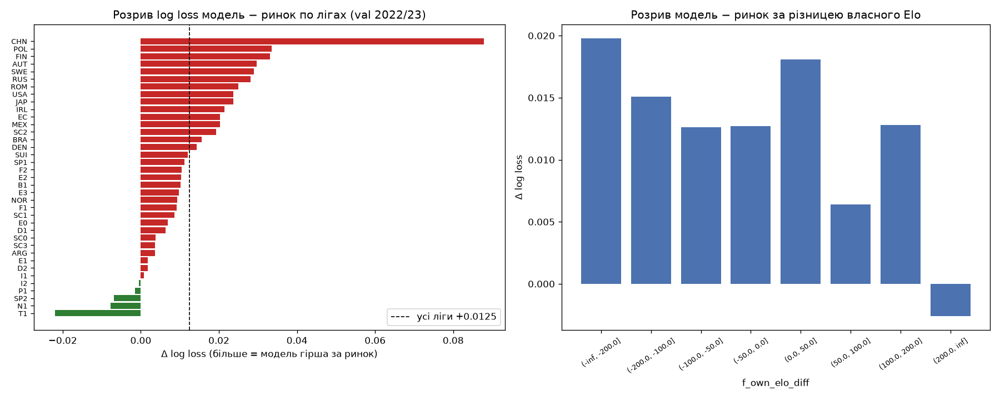
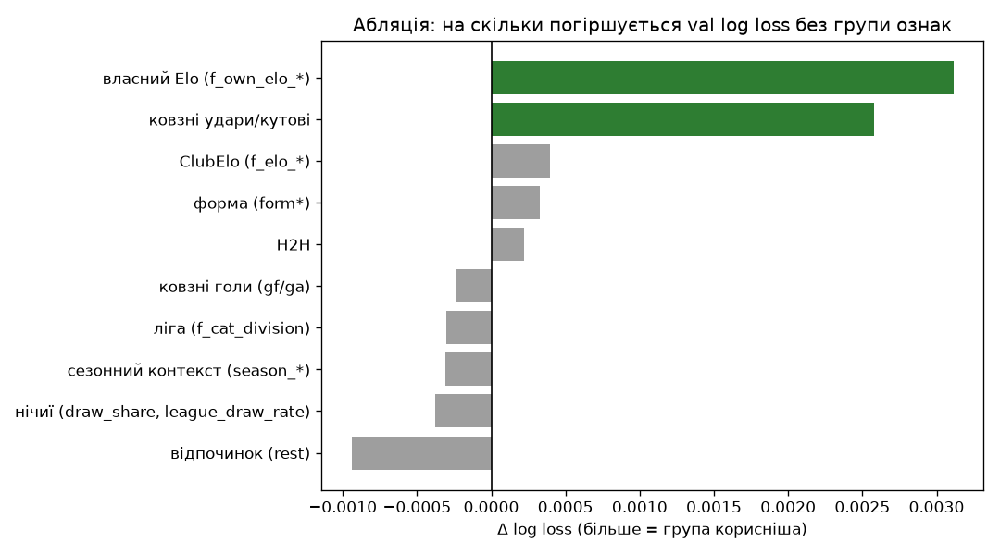
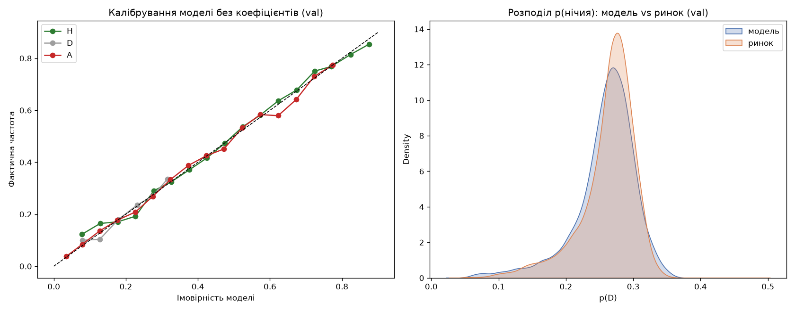
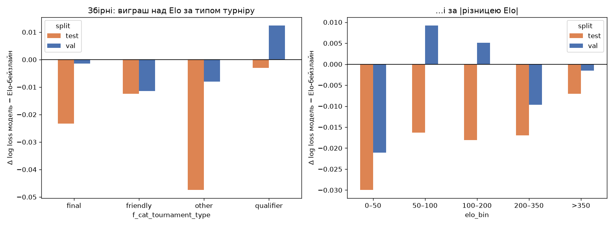

# Аналіз помилок моделей

Висновки для покращення — лише на validation (сезон 2022/23, моделі навчені на train). Test (з 2023-07-01) — тільки для ілюстрацій. Модель: `final_no_odds` (ансамбль LightGBM + логрегресія, v2); ринок — імовірності букмекерів без маржі (`baseline_odds`). Згенеровано `python -m src.error_analysis`.

## Головне (validation 2022/23, якщо не сказано інше)

1. **Модель без коефіцієнтів відстає від ринку на +0.0125 log loss** (1.0099 vs 0.9974). Розрив однаковий на кожному сезоні test (+0.011…+0.013), тобто це не дрейф у часі. Моделі бракує інформації, і підбір гіперпараметрів цього не закриє.
2. **75% розриву дають матчі без ClubElo**: там +0.0213 (5 449 матчів), де ClubElo є — +0.0055. Майже так само ділить вибірку статистика ударів: без неї +0.0226, з нею +0.0047. Найбільші розриви по лігах: CHN +0.088, POL +0.033, FIN +0.033, AUT +0.030, SWE +0.029, RUS +0.028. Топ-ліги (E0, I1, D1, F1) відстають лише на +0.001…+0.009.
3. **Початок сезону**: якщо команда зіграла 0–3 матчі сезону, розрив +0.020; після 25+ матчів — +0.0075. Короткий відпочинок (≤5 днів) дає +0.017…+0.019, при 6–8 днях — +0.008. Новачки ліги окремою проблемою не є (+0.008).
4. **Абляція** (LightGBM з фіксованими параметрами, 80k матчів train): найкорисніші групи — власний Elo (без нього log loss гірший на +0.0031) і ковзні удари/кутові (+0.0026). ClubElo поверх власного Elo дає лише +0.0004, форма +0.0003, H2H +0.0002. Сезонний контекст, нічиї, відпочинок і ліга в межах шуму (−0.0009…−0.0003). Модель «лише Elo + ліга» гірша за повну всього на 0.0012: решта ~80 ознак разом додає дуже мало.
5. **Залишки проти ринку** (p_ринку(H) − p_моделі(H)) наявні ознаки пояснюють лише на R² = 0.094. Тобто розбіжність майже вся у відсутній інформації (склади, трансфери, мотивація), а не в недонавченні. Найбільша важливість у залишку — `f_cat_division` (24% gain): модель систематично завищує p(H) відносно ринку в CHN (−0.034), USA (−0.032), SP1 (−0.025), BRA (−0.024).
6. **Калібрування в середньому ідеальне** (H 0.442 vs факт 0.443, D 0.258 vs 0.259), але нічия стає argmax лише в 0.3% матчів, а p(D) моделі майже не виходить за 0.34. По лігах є систематичні зсуви за нічиїми: DEN −6.9 п.п., SUI −5.3 п.п. (модель недооцінює нічиї), P1 +5.2, NOR +4.8, SC0 +4.1 (переоцінює). Це один сезон, тож шум ±2–3 п.п.
7. **Збірні**: модель краща за бейзлайн «лише Elo» майже скрізь на test (найбільше в «other» −0.047, на нейтральному полі −0.027, у CONCACAF −0.039). Але на val (780 матчів) у відборах (+0.012) і на нейтральному полі (+0.008) вона навіть трохи гірша за Elo. Виграш дуже малий і нестабільний.
8. **Найбільші промахи** — фаворити топ-клубів (PSV, Celtic, Sporting, Bayern) із p(H) 0.91–0.94, які зіграли внічию або програли. Ринок у цих матчах давав фактичному результату в середньому 0.095, модель — 0.048: на крайніх імовірностях модель упевненіша за ринок.

Графіки: `reports/figures/err_gap_by_league_elo.png`, `err_calibration.png`, `err_ablation.png`, `err_intl.png`.

## 1. Де модель без коефіцієнтів програє ринку (validation 2022/23)

Validation: 12,368 матчів із коефіцієнтами. Log loss моделі `final_no_odds` (навчена лише на train) = 1.0099, ринку = 0.9974, розрив = **+0.0125**. `gap` — середня різниця log loss (модель − ринок) у сегменті, `gap_total` — внесок сегмента в загальний розрив.

**Фаза сезону**

| phase | n | ll_model | ll_market | gap | gap_total |
|---|---|---|---|---|---|
| 1 початок (лип–вер) | 3018 | 1.012 | 0.9962 | 0.0157 | 0.0038 |
| 2 середина (жов–лют) | 5181 | 1.014 | 1.001 | 0.0134 | 0.0056 |
| 3 кінець (бер–чер) | 4169 | 1.003 | 0.9941 | 0.009 | 0.003 |

**Різниця власного Elo (господарі − гості)**

| elo_bin | n | ll_model | ll_market | gap | gap_total |
|---|---|---|---|---|---|
| (-inf, -200.0] | 894 | 0.9242 | 0.9044 | 0.0198 | 0.0014 |
| (-200.0, -100.0] | 1849 | 1.073 | 1.058 | 0.0151 | 0.0023 |
| (-100.0, -50.0] | 1566 | 1.087 | 1.074 | 0.0126 | 0.0016 |
| (-50.0, 0.0] | 1910 | 1.082 | 1.07 | 0.0127 | 0.002 |
| (0.0, 50.0] | 1901 | 1.061 | 1.042 | 0.0181 | 0.0028 |
| (50.0, 100.0] | 1504 | 1.029 | 1.023 | 0.0064 | 0.0008 |
| (100.0, 200.0] | 1805 | 0.939 | 0.9262 | 0.0128 | 0.0019 |
| (200.0, inf] | 939 | 0.6943 | 0.697 | -0.0026 | -0.0002 |

**Є ClubElo**

| has_clubelo | n | ll_model | ll_market | gap | gap_total |
|---|---|---|---|---|---|
| False | 5449 | 1.027 | 1.006 | 0.0213 | 0.0094 |
| True | 6919 | 0.9963 | 0.9908 | 0.0055 | 0.0031 |

**Є ковзна статистика ударів**

| has_shots | n | ll_model | ll_market | gap | gap_total |
|---|---|---|---|---|---|
| False | 5382 | 1.017 | 0.9948 | 0.0226 | 0.0098 |
| True | 6986 | 1.004 | 0.9994 | 0.0047 | 0.0026 |

**У матчі є новачок ліги**

| any_new | n | ll_model | ll_market | gap | gap_total |
|---|---|---|---|---|---|
| False | 9154 | 1.006 | 0.9923 | 0.0141 | 0.0104 |
| True | 3214 | 1.02 | 1.012 | 0.008 | 0.0021 |

**Мінімальний відпочинок, днів**

| rest_bin | n | ll_model | ll_market | gap | gap_total |
|---|---|---|---|---|---|
| ≤3 | 2326 | 1.016 | 0.9985 | 0.0171 | 0.0032 |
| 4–5 | 2468 | 1.014 | 0.9949 | 0.0186 | 0.0037 |
| 6–8 | 5277 | 1.004 | 0.9961 | 0.0084 | 0.0036 |
| 9–15 | 1395 | 1.02 | 1.009 | 0.0112 | 0.0013 |
| >15 | 902 | 1.002 | 0.9918 | 0.01 | 0.0007 |

**Ліги (відсортовано за внеском у розрив)**

| competition | n | ll_model | ll_market | gap | gap_total |
|---|---|---|---|---|---|
| CHN | 324 | 0.9455 | 0.8577 | 0.0878 | 0.0023 |
| USA | 514 | 1.045 | 1.021 | 0.0237 | 0.001 |
| EC | 552 | 1.012 | 0.9922 | 0.0203 | 0.0009 |
| POL | 310 | 1.034 | 1.001 | 0.0334 | 0.0008 |
| ROM | 329 | 1.014 | 0.9885 | 0.025 | 0.0007 |
| MEX | 359 | 1.027 | 1.007 | 0.0203 | 0.0006 |
| SWE | 242 | 1.013 | 0.9837 | 0.0289 | 0.0006 |
| RUS | 248 | 0.9726 | 0.9445 | 0.0282 | 0.0006 |
| JAP | 288 | 1.057 | 1.034 | 0.0237 | 0.0006 |
| BRA | 374 | 1.002 | 0.9868 | 0.0155 | 0.0005 |
| AUT | 194 | 0.9807 | 0.9511 | 0.0296 | 0.0005 |
| E2 | 552 | 1.016 | 1.006 | 0.0103 | 0.0005 |
| FIN | 170 | 1.038 | 1.005 | 0.0331 | 0.0005 |
| E3 | 552 | 1.064 | 1.054 | 0.0098 | 0.0004 |
| SP1 | 380 | 0.9911 | 0.9799 | 0.0112 | 0.0003 |
| F2 | 379 | 1.046 | 1.036 | 0.0105 | 0.0003 |
| IRL | 176 | 0.9721 | 0.9506 | 0.0215 | 0.0003 |
| F1 | 380 | 0.9804 | 0.9712 | 0.0092 | 0.0003 |
| SC2 | 180 | 0.9786 | 0.9593 | 0.0193 | 0.0003 |
| B1 | 306 | 0.9771 | 0.9669 | 0.0102 | 0.0003 |
| DEN | 202 | 1.063 | 1.049 | 0.0143 | 0.0002 |
| E0 | 380 | 0.9728 | 0.9658 | 0.007 | 0.0002 |
| SUI | 194 | 1.067 | 1.055 | 0.0121 | 0.0002 |
| NOR | 247 | 0.9486 | 0.9392 | 0.0094 | 0.0002 |
| ARG | 608 | 1.06 | 1.057 | 0.0036 | 0.0002 |
| D1 | 306 | 1.002 | 0.9959 | 0.0063 | 0.0002 |
| SC1 | 180 | 1.077 | 1.069 | 0.0087 | 0.0001 |
| E1 | 552 | 1.058 | 1.056 | 0.0018 | 0.0001 |
| SC0 | 228 | 0.881 | 0.8772 | 0.0038 | 0.0001 |
| SC3 | 180 | 1.063 | 1.06 | 0.0037 | 0.0001 |
| D2 | 306 | 1.024 | 1.022 | 0.0017 | 0 |
| I1 | 380 | 0.981 | 0.9802 | 0.0008 | 0 |
| I2 | 380 | 1.064 | 1.064 | -0.0005 | -0 |
| P1 | 306 | 0.8734 | 0.875 | -0.0015 | -0 |
| N1 | 306 | 0.9207 | 0.9285 | -0.0078 | -0.0002 |
| SP2 | 462 | 1.036 | 1.043 | -0.007 | -0.0003 |
| T1 | 342 | 0.9577 | 0.9796 | -0.0219 | -0.0006 |

**Скільки матчів сезону вже зіграла команда (мінімум із двох)**

| played_bin | n | ll_model | ll_market | gap | gap_total |
|---|---|---|---|---|---|
| 0 | 429 | 1.025 | 1.005 | 0.0198 | 0.0007 |
| 1–3 | 1130 | 1.01 | 0.9901 | 0.0196 | 0.0018 |
| 4–8 | 1761 | 1.016 | 1.002 | 0.0137 | 0.002 |
| 9–15 | 2404 | 1.018 | 1.002 | 0.0163 | 0.0032 |
| 16–25 | 3213 | 1.002 | 0.9907 | 0.0108 | 0.0028 |
| >25 | 3431 | 1.007 | 0.9993 | 0.0075 | 0.0021 |

**Test (лише ілюстрація): розрив по сезонах**

| season | n | ll_model | ll_market | gap | gap_total |
|---|---|---|---|---|---|
| 2023 | 12140 | 1.017 | 1.005 | 0.0117 | 0.0049 |
| 2024 | 8766 | 1.013 | 1 | 0.0132 | 0.0039 |
| 2025 | 7646 | 1.016 | 1.003 | 0.013 | 0.0034 |
| 2026 | 654 | 1.016 | 1.006 | 0.0107 | 0.0002 |

## 2. Що ринок знає, а модель ні: залишок r = p_ринку(H) − p_моделі(H)

Середнє |r_H| = 0.052, std r_H = 0.069; середнє r_D = +0.0037 (модель занижує нічию відносно ринку).

LightGBM на залишок (навчання на 1-й половині val, перевірка на 2-й): R² = **0.094** — частка розбіжності з ринком, яку можна пояснити наявними ознаками (тобто модель їх недовикористовує).

| index | gain_% | spearman_r_H |
|---|---|---|
| f_cat_division | 24.17 | nan |
| f_elo_diff | 6.095 | -0.46 |
| f_season_ppg_diff | 4.678 | -0.23 |
| f_home_season_gdpg | 3.051 | -0.175 |
| f_own_elo_home | 2.738 | -0.106 |
| f_own_elo_diff | 2.683 | -0.218 |
| f_away_season_gdpg | 2.656 | 0.151 |
| f_away_season_ppg | 2.474 | 0.15 |
| f_own_elo_away | 2.396 | 0.077 |
| f_elo_home | 2.28 | -0.245 |
| f_away_gf_venue10 | 2.118 | 0.071 |
| f_elo_away | 1.452 | 0.122 |
| f_away_form_ewm | 1.428 | 0.135 |
| f_home_season_ppg | 1.351 | -0.167 |
| f_home_ga_all10 | 1.337 | 0.131 |

Найбільший систематичний зсув p(H) відносно ринку по лігах (mean r_H > 0 — ринок дає господарям більше):

| competition | mean | size |
|---|---|---|
| CHN | -0.034 | 324 |
| USA | -0.032 | 514 |
| SP1 | -0.025 | 380 |
| BRA | -0.024 | 374 |
| AUT | 0.004 | 194 |
| E3 | 0.004 | 552 |
| SC1 | 0.005 | 180 |
| SWE | 0.01 | 242 |

Зсув для новачків ліги (home_new, away_new):

| home_new | away_new | mean | size |
|---|---|---|---|
| False | False | -0.011 | 9154 |
| False | True | -0.02 | 1435 |
| True | False | 0.001 | 1428 |
| True | True | -0.009 | 351 |

## 3. Калібрування моделі без коефіцієнтів (val)

| клас | факт | середня p моделі | середня p ринку | max p моделі (99-й перц.) | частка матчів, де клас — argmax моделі |
|---|---|---|---|---|---|
| H | 0.443 | 0.442 | 0.431 | 0.858 | 0.716 |
| D | 0.259 | 0.258 | 0.262 | 0.339 | 0.003 |
| A | 0.298 | 0.3 | 0.307 | 0.728 | 0.281 |

Ліги з найбільшим зсувом (модель − факт) за нічиїми і перемогами господарів (на одному сезоні val, шум ±2–3 п.п. при n≈300):

| competition | n | D факт | D модель | H факт | H модель | D зсув | H зсув |
|---|---|---|---|---|---|---|---|
| DEN | 202 | 0.327 | 0.258 | 0.391 | 0.429 | -0.069 | 0.038 |
| SUI | 194 | 0.304 | 0.251 | 0.392 | 0.434 | -0.053 | 0.043 |
| P1 | 306 | 0.18 | 0.232 | 0.49 | 0.449 | 0.052 | -0.041 |
| NOR | 247 | 0.19 | 0.238 | 0.506 | 0.477 | 0.048 | -0.029 |
| SC0 | 228 | 0.175 | 0.216 | 0.518 | 0.427 | 0.041 | -0.091 |
| USA | 514 | 0.28 | 0.245 | 0.486 | 0.511 | -0.036 | 0.025 |
| F2 | 379 | 0.272 | 0.307 | 0.441 | 0.424 | 0.036 | -0.017 |
| JAP | 288 | 0.278 | 0.243 | 0.392 | 0.408 | -0.035 | 0.016 |

## 4. Групова абляція (клуби, без коефіцієнтів)

LightGBM із фіксованими параметрами (350 дерев, lr 0.05), train — випадкові 80 000 матчів сезонів 2014–2021, оцінка на всьому val (12,368). Δ > 0 — без групи гірше (група корисна); Δ ≈ 0 або < 0 — шум. Шум самої процедури ~±0.001.

| група | n_ознак | val log loss | Δ без групи |
|---|---|---|---|
| усі ознаки (база) | 88 | 1.016 | 0 |
| ClubElo (f_elo_*) | 4 | 1.016 | 0.0004 |
| власний Elo (f_own_elo_*) | 5 | 1.019 | 0.0031 |
| форма (form*) | 13 | 1.016 | 0.0003 |
| ковзні голи (gf/ga) | 16 | 1.016 | -0.0002 |
| ковзні удари/кутові | 32 | 1.018 | 0.0026 |
| H2H | 4 | 1.016 | 0.0002 |
| сезонний контекст (season_*) | 7 | 1.016 | -0.0003 |
| нічиї (draw_share, league_draw_rate) | 3 | 1.015 | -0.0004 |
| відпочинок (rest) | 3 | 1.015 | -0.0009 |
| ліга (f_cat_division) | 1 | 1.016 | -0.0003 |
| ЛИШЕ Elo (обидва) + ліга | 10 | 1.017 | 0.0012 |

## 5. Збірні: де модель виграє/програє в бейзлайну «лише Elo»

Validation збірних: лише 780 матчів, тому сегменти шумні; поруч — test (3681) як ілюстрація. `gap` < 0 — модель краща за Elo-бейзлайн.

**Тип турніру**

| f_cat_tournament_type | n_val | ll_model_val | gap_val | D_fact_val | n_test | ll_model_test | gap_test | D_fact_test |
|---|---|---|---|---|---|---|---|---|
| final | 173 | 1.022 | -0.001 | 0.197 | 977 | 0.876 | -0.023 | 0.228 |
| friendly | 302 | 0.927 | -0.011 | 0.242 | 854 | 0.888 | -0.012 | 0.253 |
| other | 134 | 0.793 | -0.008 | 0.224 | 468 | 0.89 | -0.047 | 0.214 |
| qualifier | 171 | 0.85 | 0.012 | 0.181 | 1382 | 0.801 | -0.003 | 0.224 |

**Нейтральне поле**

| f_neutral | n_val | ll_model_val | gap_val | D_fact_val | n_test | ll_model_test | gap_test | D_fact_test |
|---|---|---|---|---|---|---|---|---|
| 0 | 479 | 0.883 | -0.011 | 0.211 | 2405 | 0.832 | -0.011 | 0.219 |
| 1 | 301 | 0.949 | 0.008 | 0.223 | 1276 | 0.891 | -0.027 | 0.252 |

**|різниця Elo|**

| elo_bin | n_val | ll_model_val | gap_val | D_fact_val | n_test | ll_model_test | gap_test | D_fact_test |
|---|---|---|---|---|---|---|---|---|
| 0–50 | 109 | 1.062 | -0.021 | 0.275 | 466 | 1.072 | -0.03 | 0.296 |
| 50–100 | 107 | 1.071 | 0.009 | 0.252 | 494 | 1.059 | -0.016 | 0.275 |
| 100–200 | 189 | 1.066 | 0.005 | 0.286 | 846 | 1.011 | -0.018 | 0.298 |
| 200–350 | 209 | 0.855 | -0.01 | 0.172 | 930 | 0.862 | -0.017 | 0.23 |
| >350 | 166 | 0.588 | -0.002 | 0.127 | 945 | 0.485 | -0.007 | 0.114 |

**Конфедерація господарів**

| confed | n_val | ll_model_val | gap_val | D_fact_val | n_test | ll_model_test | gap_test | D_fact_test |
|---|---|---|---|---|---|---|---|---|
| AFC | 219 | 0.842 | -0.004 | 0.219 | 756 | 0.854 | -0.01 | 0.239 |
| CAF | 154 | 0.997 | 0.012 | 0.234 | 858 | 0.922 | -0.004 | 0.269 |
| CONCACAF | 107 | 0.962 | -0.033 | 0.234 | 657 | 0.847 | -0.039 | 0.205 |
| CONMEBOL | 39 | 0.652 | 0.014 | 0.154 | 193 | 0.794 | 0.005 | 0.228 |
| OFC | 15 | 1.052 | -0.046 | 0.133 | 103 | 0.766 | -0.102 | 0.136 |
| UEFA | 240 | 0.905 | -0.009 | 0.204 | 1037 | 0.823 | -0.007 | 0.227 |
| other | 6 | 1.51 | 0.37 | 0.333 | 77 | 0.771 | -0.088 | 0.104 |

Нічиї у val збірних: факт 0.215, середня p моделі 0.228, нічия — argmax моделі в 2.1% матчів.

## 6. Найбільші промахи (test, модель без коефіцієнтів) — ілюстрація

| date | competition | home | away | рахунок | pred | conf | p_fact_model | p_fact_market |
|---|---|---|---|---|---|---|---|---|
| 2026-04-29 | P1 | Sp Lisbon | Tondela | 2:2 | H | 0.939 | 0.044 | 0.122 |
| 2025-02-08 | N1 | PSV Eindhoven | Willem II | 1:1 | H | 0.928 | 0.052 | 0.096 |
| 2025-08-30 | N1 | PSV Eindhoven | Telstar | 0:2 | H | 0.919 | 0.024 | 0.05 |
| 2023-08-26 | SC0 | Celtic | St Johnstone | 0:0 | H | 0.919 | 0.059 | 0.065 |
| 2023-11-25 | SC0 | Celtic | Motherwell | 1:1 | H | 0.915 | 0.063 | 0.112 |
| 2026-01-24 | N1 | PSV Eindhoven | NAC Breda | 2:2 | H | 0.915 | 0.059 | 0.145 |
| 2026-05-02 | D1 | Bayern Munich | Heidenheim | 3:3 | H | 0.911 | 0.061 | 0.136 |
| 2024-03-02 | SC0 | Rangers | Motherwell | 1:2 | H | 0.91 | 0.026 | 0.06 |
| 2024-11-30 | P1 | Sp Lisbon | Santa Clara | 0:1 | H | 0.909 | 0.024 | 0.058 |
| 2024-08-10 | N1 | Feyenoord | Willem II | 1:1 | H | 0.908 | 0.066 | 0.101 |

Для порівняння: у тих самих 10 матчах ринок давав фактичному результату в середньому 0.095, модель — 0.048. Це «сенсації», яких не бачив ніхто.

## Чого модель не може знати з наявних даних

- **Склади**: травми, дискваліфікації, ротація перед єврокубками, перший матч нового тренера. Ринок це бачить, ми ні. Найімовірніше, саме це — основна частина розриву +0.0125, яку наші ознаки пояснюють лише на R² ≈ 0.09.
- **Трансфери між сезонами**: на старті сезону модель бачить силу команди за минулий рік (розрив +0.020 у перших 3 турах). Transfermarkt (f_tm_*) закриває це лише для топ-ліг з ~2012 року.
- **Мотивація й турнірна ситуація**: боротьба за виживання, «мертві» матчі наприкінці сезону, дербі.
- **Сила ліг без ClubElo і без статистики** (CHN, USA, скандинави, Східна Європа): там є лише рахунки, і на них модель найслабша.
- **Погода, поле, суддя, ранній час матчу** — у даних цього немає.
- **Сенсації**: навіть ринок дає фактичному результату в найбільших промахах ~10%. Таке не прогнозується.
